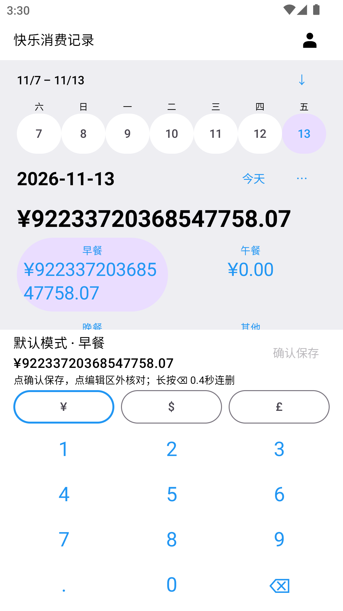
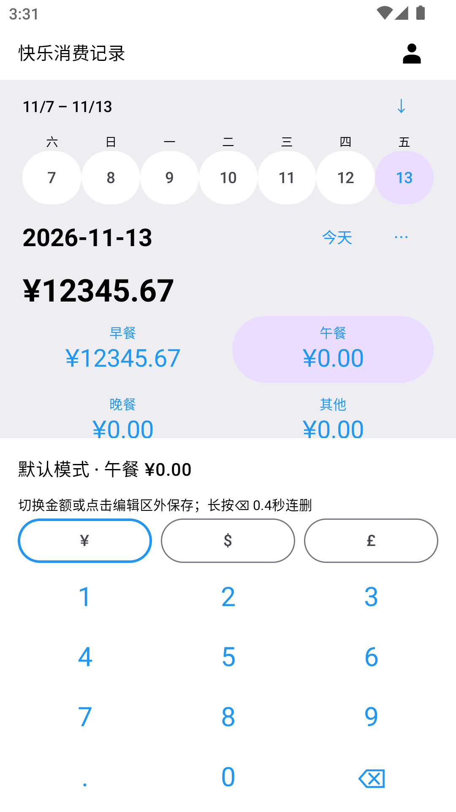
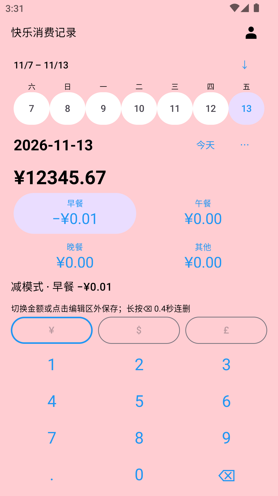

# 快乐消费记录 · Happy Consumption Recorder

轻量离线 Android 应用，按天记录早餐、午餐、晚餐和其他支出。

**v1.7 · Android 8.0+ · 中文 / English / 日本語 · 无网络权限**

[下载 v1.7 APK](https://github.com/foreign-a/happy-consumption-recorder/releases/download/v1.7/app-release_1.7.apk) · [Release 与校验文件](https://github.com/foreign-a/happy-consumption-recorder/releases/tag/v1.7)

## v1.7 更新

- 金额继续使用 `Long` 整数分保存，取消原来每项 `9999.99` 的限制。每项支持 `0`～`92233720368547758.07`，最多两位小数；超出整数分范围的输入或加法会明确拒绝，减法不能产生负数。不会转换为浮点金额或改变已有记录。
- 每日、月度合计采用精确整数累计，多项大金额相加不会溢出；各币种仍分别统计。备份保留原有整数分格式。
- 所有模式的删除键改为按住 **400 毫秒**后开始连续删除，每 **80 毫秒**删除一位，约每秒 **12.5 位**；松手或手势取消立即停止。短按仍删除一位。

沿用官方签名，直接覆盖安装旧官方版本，不要先卸载。数据库结构未变。消费备份兼容旧格式；记账方式、确认方案、时区、三餐和配色均属本机偏好，不包含在消费备份中。

## 原有功能

- 单日平面首页与常驻数字键盘，右上角切换首页与用户页。通过七天日期栏或月历查看过去记录；空白过去日期直接创建全零记录，未来日期不可创建。
- 用户页按账户选择默认模式或加减模式，以及快捷或谨慎确认方案。默认模式输入新金额替换原值；加减模式输入本次增减金额，进入时默认为加，双击任意金额切换适用于四项消费的加／减操作。减模式从双击位置以圆形扩散为红色，再次双击恢复加模式与原背景。保存后清空本次输入并保留编辑位置，可以连续记账。
- 加减沿用原币种；修改币种请切换默认模式。保存失败保留输入；加减保存前核对原记录，避免覆盖已变更的数据。设置按账户保存在本机。
- 日期行“⋯ → 删除”统一选择过去记录，支持跨月多选、全选本月和核对后批量删除，事务失败整批回滚。今天和未来日期受保护。
- 按账户设置IANA时区及三餐时间，打开应用时建议最近且不超过3小时的餐次，其余时段选中其他。
- 月度每日消费圆角条形图、点击日期查看四项明细与合计、每日占比饼图及自定义四类颜色。
- 人民币、美元、英镑分别统计，不作汇率转换；每项金额以非负Long整数分保存，最多两位小数。默认模式留空保持原值，输入0归零；加减模式输入0不改变金额。
- 本地多账户隔离、中文/英文/日文、加密备份恢复、验证密码删除账户。默认币种仅用于新增记录。

## 界面预览

| 谨慎模式 | 快捷模式 | 减模式 |
| --- | --- | --- |
|  |  |  |

截图来自合成测试账户，用户页及横屏内容可以滚动。

## 安装与备份

覆盖安装旧官方版本可以保留本地账户和记录。卸载或清除数据前，在“用户 → 备份与恢复”按账户导出`.hcrbackup`，记住至少8字符的独立备份密码，文件保存在应用外。恢复后使用原账户密码登录。无云同步或密码找回。

## 验证

81项JVM测试与55项Android设备回归通过；调试和正式构建通过，Lint为0错误、17项警告。模拟器已验证覆盖升级与正式包按住删除；实体手机尚未验证。

[详细验收摘要](docs/reports/version-1.7-report.md)。正式包沿用原证书，签名及升级验证结果见验收摘要。

SHA-256：`9e17944dd730eaefc66bded02bd46063920b5b61b0db81ed1e185b9a9a100720`

## English / 日本語

v1.7 keeps amounts in Long integer minor units and removes the former 9999.99 cap. Each amount supports 0–92233720368547758.07 with at most two decimal places. Out-of-range input, addition overflow and negative subtraction results are rejected. Daily and monthly totals remain exact even when their sum exceeds Long. Hold Delete for 400 ms to start deleting one character every 80 ms (about 12.5 per second); release or cancel to stop immediately. Short presses still delete one character. Install over the previous official version to retain local data.

v1.7では金額をLongの整数最小通貨単位で保存したまま、従来の9999.99の上限を撤廃しました。各金額は0～92233720368547758.07、小数点以下2桁まで対応します。保存範囲外の入力、加算のオーバーフロー、負数となる減算は拒否します。日計・月計も正確に集計します。削除キーを400ミリ秒押し続けると80ミリ秒ごとに1桁（毎秒約12.5桁）削除し、指を離すか操作を取り消すと直ちに停止します。短押しでは1桁だけ削除します。旧公式版へ上書き更新してください。
