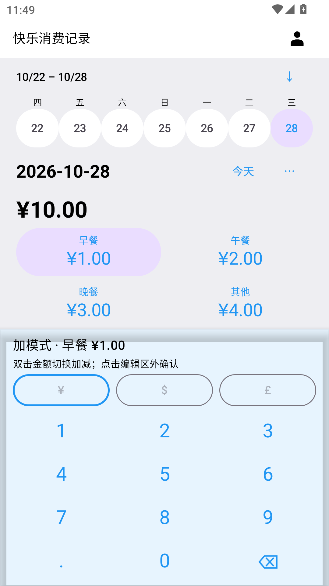
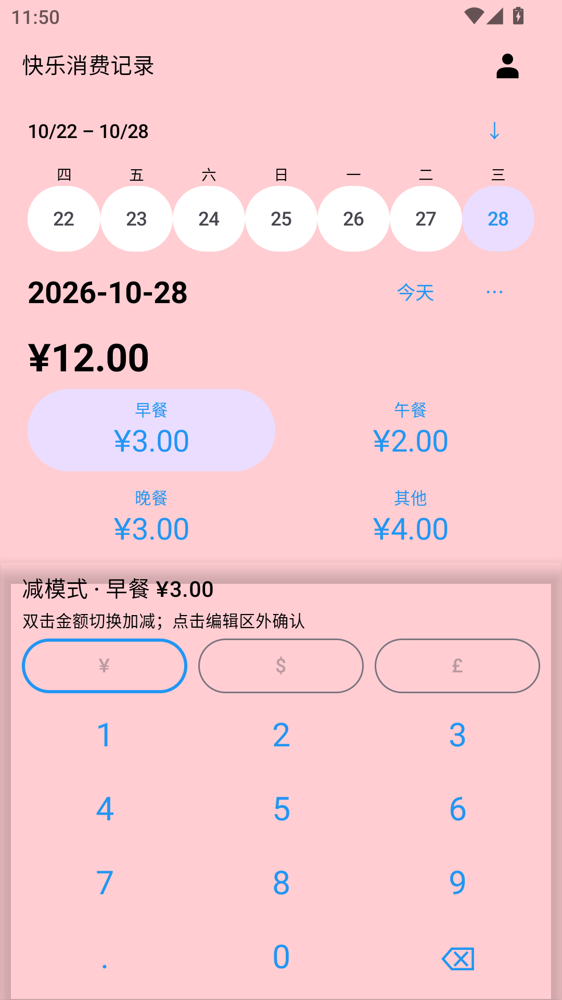
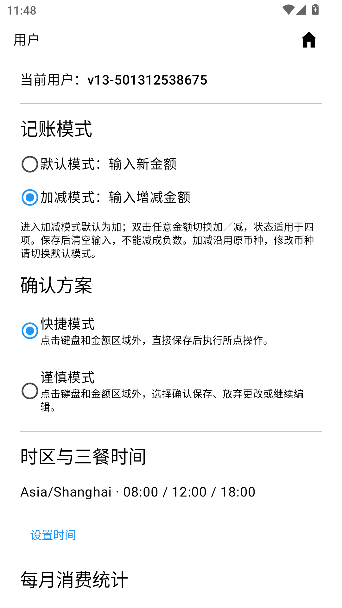

# 快乐消费记录 · Happy Consumption Recorder

轻量离线 Android 应用，按天记录早餐、午餐、晚餐和其他支出。

**v1.5 · Android 8.0+ · 中文 / English / 日本語 · 无网络权限**

[下载 v1.5 APK](https://github.com/foreign-a/happy-consumption-recorder/releases/download/v1.5/app-release_1.5.apk) · [Release 与校验文件](https://github.com/foreign-a/happy-consumption-recorder/releases/tag/v1.5)

## v1.5 更新

- 用户页新增记账模式：默认模式输入新金额替换原值；加减模式输入本次增减金额。进入加减模式默认为加，双击任意金额切换加／减，状态适用于四项消费。保存后清空本次输入并保持当前编辑项，可以连续记账。
- 减模式背景从双击位置以圆形扩散为红色，再次双击任意金额恢复加模式与原背景。金额不能减成负数，也不能超过9999.99。加减沿用原币种；修改币种请切换默认模式。
- 移除金额确认按钮。点击键盘和四项金额区域外（含空白与导航按钮）处理本次输入。用户页可选择快捷模式直接保存，或谨慎模式选择“确认保存／放弃更改／继续编辑”。首次升级默认谨慎模式。
- 设置按账户保存在本机。保存失败保留输入；加减保存前核对原记录，避免覆盖已变更的数据。

沿用官方签名，直接覆盖安装旧官方版本，不要先卸载。已验证正式v1.4 → v1.5，77条合成记录、账户凭据及原有偏好保持一致。数据库结构未变。消费备份兼容旧格式；记账方式、确认方案、时区、三餐和配色均属本机偏好，不包含在消费备份中。

65项JVM测试、20项Android设备测试通过；构建和Lint通过（0错误、15项警告）。验证设备为MuMu Android12/API32，实体手机尚未验证。

## 原有功能

- 单日平面首页与常驻数字键盘，右上角切换首页与用户页。通过七天日期栏或月历查看过去记录；空白过去日期直接创建全零记录，未来日期不可创建。
- 日期行“⋯ → 删除”统一选择过去记录，支持跨月多选、全选本月和核对后批量删除，事务失败整批回滚。今天和未来日期受保护。
- 按账户设置IANA时区及三餐时间，打开应用时建议最近且不超过3小时的餐次，其余时段选中其他。
- 月度每日消费圆角条形图、点击日期查看四项明细与合计、每日占比饼图及自定义四类颜色。
- 人民币、美元、英镑分别统计，不作汇率转换；每项金额范围0～9999.99，最多两位小数。默认模式留空保持原值，输入0归零；加减模式输入0不改变金额。
- 本地多账户隔离、中文/英文/日文、加密备份恢复、验证密码删除账户。默认币种仅用于新增记录。

## 界面预览

| 加模式 | 减模式 | 用户设置 |
| --- | --- | --- |
|  |  |  |

截图来自合成测试账户，用户页及横屏内容可以滚动。

## 安装与备份

覆盖安装旧官方版本可以保留本地账户和记录。卸载或清除数据前，在“用户 → 备份与恢复”按账户导出`.hcrbackup`，记住至少8字符的独立备份密码，文件保存在应用外。恢复后使用原账户密码登录。无云同步或密码找回。

## 验证

[详细验收摘要](docs/reports/version-1.5-report.md)。正式包沿用原证书，v2/v3签名通过。

SHA-256：`1bd009f8ae2ed25f83b47b29df170be165be2a39e5de86d8898ac105666351d6`

## English / 日本語

v1.5 adds per-account Replace or Add/Subtract entry modes. Double-tap any amount to toggle the shared operation; subtract reveals a red background from the tap position. Tap outside the keypad and four amount areas to save immediately (Quick), or choose Save/Discard/Keep editing (Careful, default). Saved deltas clear for continuous entry. Negative results are rejected. Install over the previous official version to retain records.

v1.5では置換／加減算モードを設定できます。金額をダブルタップすると加算と減算が切り替わり、減算時は背景が円形に赤く広がります。入力領域の外側をタップして即時保存、または保存・破棄・編集続行を選択します（初期設定）。旧公式版へ上書き更新してください。

## 从源码构建

需要 **JDK 17**、Android SDK Platform **36**、Build Tools **36.0.0** 和 Platform Tools。仓库包含 Gradle Wrapper；首次构建需要下载依赖。

```sh
git clone https://github.com/foreign-a/happy-consumption-recorder.git
cd happy-consumption-recorder
```

用 Android Studio 打开仓库根目录并配置 SDK，或通过 `ANDROID_HOME` / 本地 `local.properties` 的 `sdk.dir` 指定 SDK 路径。`local.properties` 不应提交。

| 操作 | macOS / Linux | Windows PowerShell |
| --- | --- | --- |
| 构建调试包 | `./gradlew assembleDebug` | `.\gradlew.bat assembleDebug` |
| 单元测试 | `./gradlew testDebugUnitTest` | `.\gradlew.bat testDebugUnitTest` |
| 静态检查 | `./gradlew lintDebug` | `.\gradlew.bat lintDebug` |
| 设备测试 | `./gradlew connectedDebugAndroidTest` | `.\gradlew.bat connectedDebugAndroidTest` |

调试 APK：`app/build/outputs/apk/debug/app-debug.apk`。设备测试会创建测试账户和大量合成记录，请使用专门的测试设备或模拟器。

正式构建启用 R8 与资源压缩。仓库不含官方签名密钥或密码：将 `keystore.properties.example` 复制到用户主目录的 `.happy-consumption-secrets/keystore.properties`，填写自己的密钥信息，运行 `./gradlew assembleRelease`（Windows：`.\gradlew.bat assembleRelease`）。未配置签名时可能生成未签名 APK，输出位于 `app/build/outputs/apk/release/`。自己签名的包无法覆盖官方版本，请妥善保管签名密钥与密码。

技术栈：Kotlin、Jetpack Compose / Material 3、AppCompat、Room、DataStore、Coroutines；构建配置采用 Gradle 9.3.1、AGP 9.1.1。`app/src/main/` 为应用与三语言资源，`app/src/test/` 和 `app/src/androidTest/` 为测试，`app/schemas/` 保存数据库结构。正式包不包含调试数据导入工具或测试设备数据。

## 隐私与许可

无网络权限、广告、上传或云同步。数据保存在本机，密码采用加盐散列，消费记录按账户隔离。[GNU GPL v3](LICENSE)。
