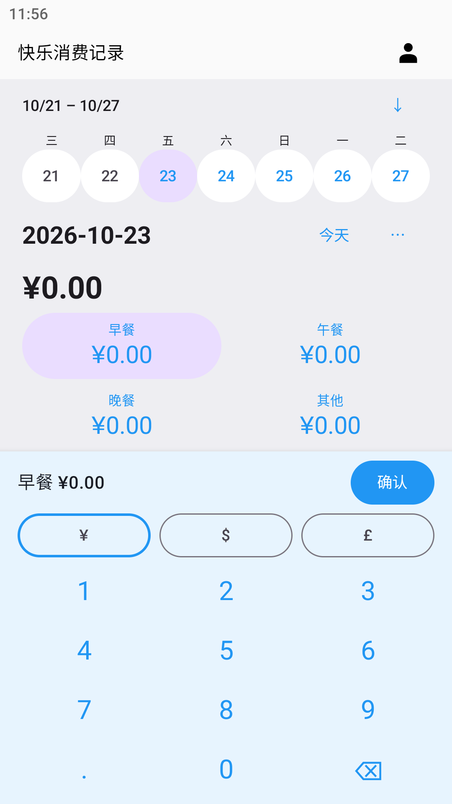
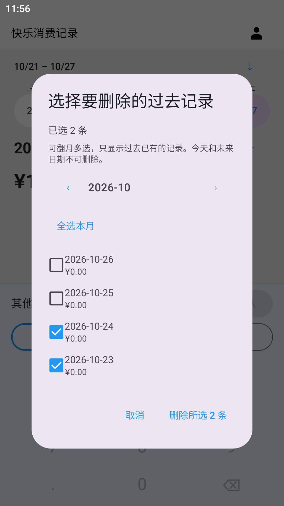
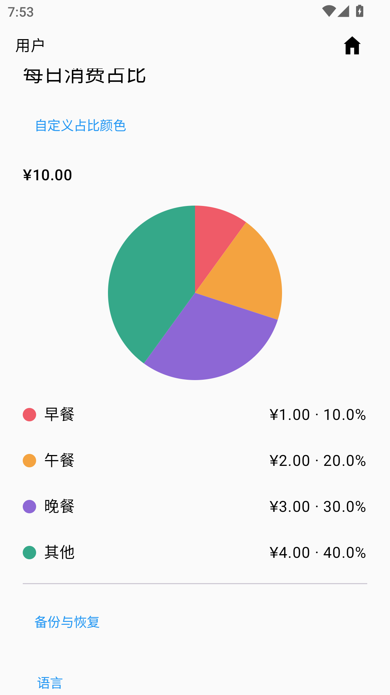

# 快乐消费记录 · Happy Consumption Recorder

轻量、离线的 Android 消费记录应用，按天记录早餐、午餐、晚餐和其他支出。

**v1.4 · Android 8.0+ · 中文 / English / 日本語 · 无网络权限**

[下载 v1.4 APK](https://github.com/foreign-a/happy-consumption-recorder/releases/download/v1.4/app-release_1.4.apk) · [Release 与校验文件](https://github.com/foreign-a/happy-consumption-recorder/releases/tag/v1.4) · [反馈问题](https://github.com/foreign-a/happy-consumption-recorder/issues)

## v1.4 更新

- **过去记录多选删除**：点击日期行“⋯ → 删除”，按月份勾选记录，支持跨月选择和全选/取消本月。核对日期与数量后统一确认删除；单个日期也走同一流程。今天和未来日期不在可删除范围内。
- **日历直接创建零记录**：点按没有记录的过去日期，立即创建四项全零记录并打开，无需生成确认。新记录使用当前账户默认币种，重复点击不覆盖已有金额或币种。
- 删除操作使用数据库事务；失败时整批回滚。未确认金额草稿仍需先保存、放弃或继续编辑。

本次从 v1.2 直接更新至 v1.4，包含此前本地完成的以下功能，不另发布 v1.3 系列：

- **单日首页与常驻键盘**：首页只展示所选一天，默认是用户时区的今天。点按金额输入并确认保存；右上角图标切换首页与用户页。
- **时区与三餐时间**：用户页设置 IANA 时区及三餐时刻。打开应用时建议距离当前时间最近且不超过3小时的餐次，其他时段选中“其他”；有未确认草稿时保留草稿。
- **月度与每日统计**：圆角条形图展示每日消费，点击某天查看四项金额和合计；饼图展示每日占比，支持为四类消费选择预设色、输入RGB色值或恢复默认。配色按账户保存，重启后保留。

## 功能与使用

1. 创建本地账户并登录，今日零记录自动生成。每项金额支持 `0～9999.99`，最多两位小数；输入新值替换原值，留空保留，输入 `0` 归零，点击“确认”保存。
2. 通过最近七天日期栏或展开月历查看历史；空白过去日期直接创建零记录。未来日期不可创建。
3. 四项金额分别支持人民币 `¥`、美元 `$`、英镑 `£`。合计、月度图表和每日占比按币种分别计算，不进行汇率转换。
4. 用户页管理时区、三餐时间、语言、默认币种、备份与账户。默认币种只用于新增记录，不重标历史金额。
5. 日期行“⋯”菜单保留生成过去30天记录和多选删除。账户数据彼此隔离；删除账户需要当前密码。

## 界面预览

| 单日首页 | 日期多选删除 | 每日占比与配色 |
| --- | --- | --- |
|  |  |  |

截图来自专用模拟器与合成测试账户。用户页及横屏内容可滚动。

## 安装、升级与备份

下载 Release 下的 `app-release_1.4.apk`，在 Android 8.0 或更高版本安装。**从旧官方版本升级请直接覆盖安装，不要先卸载。** v1.4 沿用正式签名；已验证从 v1.3.1 覆盖升级，账户、记录和时间/配色偏好均保留。数据库结构沿用现有版本。

卸载或清除应用数据会删除本地数据。操作前请在“用户 → 备份与恢复”按账户导出 `.hcrbackup` 文件，设置并记住至少8字符的独立备份密码，将文件保存到应用外。重装后从登录页导入，再使用原账户密码登录。无云同步或密码找回功能。

消费备份继续兼容旧格式与逐项币种；时区、三餐时间和配色属于本机账户偏好，不包含在消费备份中，导入后需重新设置。同名账户、错误密码或无效文件不会覆盖已有记录。

## 验证

- 58项JVM单元测试、12项Android设备测试、10项最终正式包检查通过。
- 覆盖跨月选择、确认与取消、事务回滚、用户隔离、过期会话、并发创建、已有金额/币种保留，以及既有记账与统计回归。
- 构建和静态检查通过，Lint 0错误、12项建议性警告。
- MuMu Android 12 / API32 验证；实体手机尚未验证。
- 正式包2,266,374字节，证书与旧官方版本相同，v2/v3签名验证通过。
- SHA-256：`2cc9b47e268edbdaeb1ae1b480835041c60fc9dcf6656f4a4cbaa53d9d2e9c89`

[详细验收摘要](docs/reports/version-1.4-report.md)

## English / 日本語

v1.4 adds multi-date deletion across months with one final confirmation. Today and future dates are protected. Tap a missing past calendar date to create a zero record immediately. Home shows one day with a persistent keypad; User provides time-zone and meal settings, monthly bars and customizable daily pie charts. Currencies are counted separately. Install over older official versions to retain data. Export each account before uninstalling; local time and color preferences are not part of spending backups.

v1.4では月をまたぐ過去の記録を複数選択して一括削除できます。今日と未来は対象外です。カレンダーの空白の過去日をタップするとゼロ記録を作成します。タイムゾーン・食事時刻、月別グラフ、色を設定できる日別円グラフにも対応します。通貨別に集計します。旧公式版へ上書き更新し、削除前にはアカウントごとにバックアップしてください。

## 从源码构建

需要 **JDK 17**、Android SDK Platform **36**、Build Tools **36.0.0** 和 Platform Tools。仓库包含 Gradle Wrapper；首次构建需要下载依赖。

```sh
git clone https://github.com/foreign-a/happy-consumption-recorder.git
cd happy-consumption-recorder
```

用 Android Studio 打开仓库根目录并配置 SDK，或通过 `ANDROID_HOME` / 本地 `local.properties` 的 `sdk.dir` 指定 SDK 路径。`local.properties` 不应提交。

| 操作 | macOS / Linux | Windows PowerShell |
| --- | --- | --- |
| 构建调试包 | `./gradlew assembleDebug` | `.\gradlew.bat assembleDebug` |
| 单元测试 | `./gradlew testDebugUnitTest` | `.\gradlew.bat testDebugUnitTest` |
| 静态检查 | `./gradlew lintDebug` | `.\gradlew.bat lintDebug` |
| 设备测试 | `./gradlew connectedDebugAndroidTest` | `.\gradlew.bat connectedDebugAndroidTest` |

调试 APK：`app/build/outputs/apk/debug/app-debug.apk`。设备测试会创建测试账户和大量合成记录，请使用专门的测试设备或模拟器。

正式构建启用 R8 与资源压缩。仓库不含官方签名密钥或密码：将 `keystore.properties.example` 复制到用户主目录的 `.happy-consumption-secrets/keystore.properties`，填写自己的密钥信息，运行 `./gradlew assembleRelease`（Windows：`.\gradlew.bat assembleRelease`）。未配置签名时可能生成未签名 APK，输出位于 `app/build/outputs/apk/release/`。自己签名的包无法覆盖官方版本，请妥善保管签名密钥与密码。

技术栈：Kotlin、Jetpack Compose / Material 3、AppCompat、Room、DataStore、Coroutines；构建配置采用 Gradle 9.3.1、AGP 9.1.1。`app/src/main/` 为应用与三语言资源，`app/src/test/` 和 `app/src/androidTest/` 为测试，`app/schemas/` 保存数据库结构。正式包不包含调试数据导入工具或测试设备数据。

## 隐私与许可

应用无网络权限，无广告、云同步或数据上传。密码使用加盐散列，Room记录按账户隔离。[GNU GPL v3](LICENSE)。
