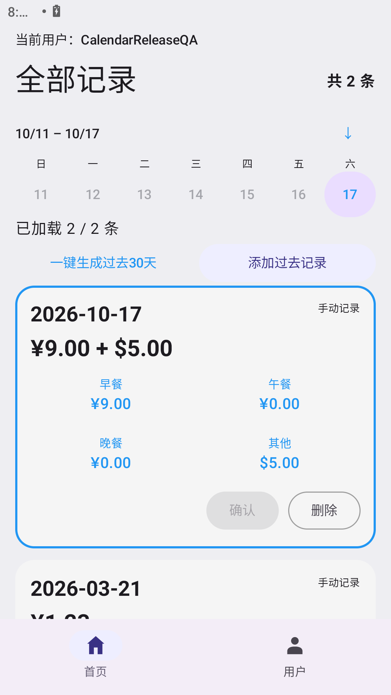
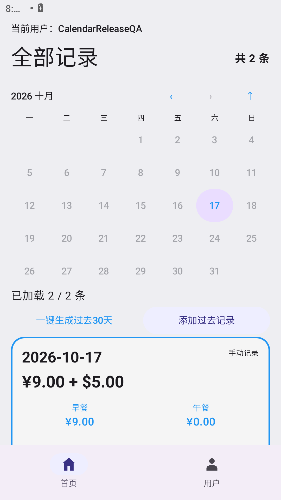
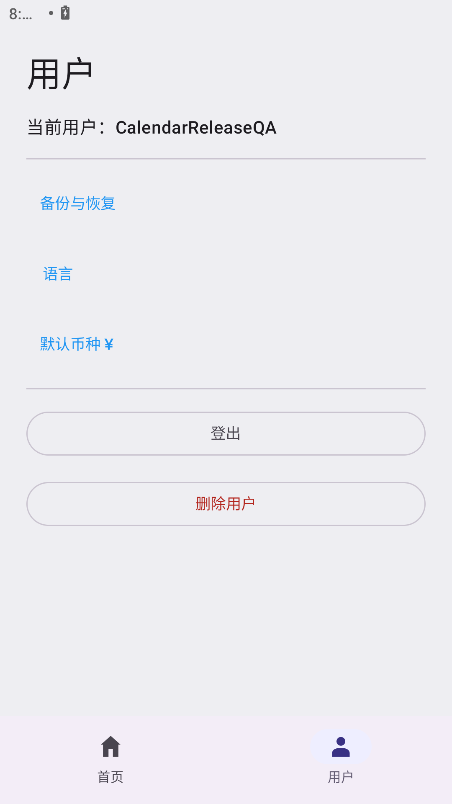
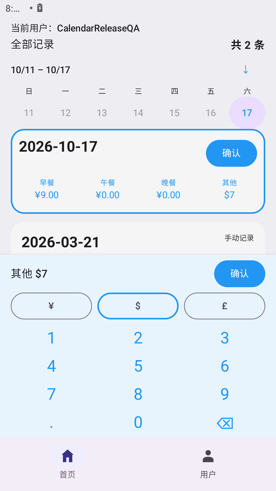
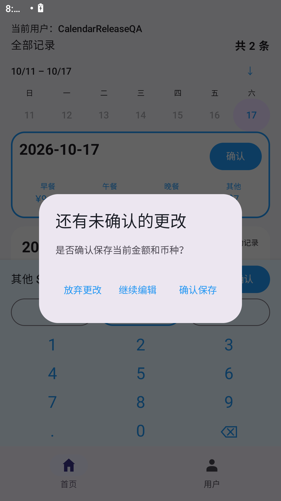

# 快乐消费记录 · Happy Consumption Recorder

一个轻量、离线的 Android 消费记录应用。按天记录早餐、午餐、晚餐和其他支出，支持逐项币种、日期导航与加密备份。

**v1.2 · Android 8.0+ · 中文 / English / 日本語 · 无网络权限**

[下载 v1.2 APK](https://github.com/foreign-a/happy-consumption-recorder/releases/download/v1.2/app-release_1.2.apk) · [版本说明与校验文件](https://github.com/foreign-a/happy-consumption-recorder/releases/tag/v1.2) · [反馈问题](https://github.com/foreign-a/happy-consumption-recorder/issues)

## 功能

- **每天四类支出**：早餐、午餐、晚餐、其他；记录按日期从新到旧排列。手动记录为灰色，自动记录为白色。
- **点按金额直接编辑**：点击金额，使用应用内电话式数字键盘输入，支持小数点和退格；点击记录或键盘中的“确认”直接保存。留空保留原金额，输入 `0` 可归零。
- **未确认更改提醒**：有实际更改时，切页、选择日期、点击编辑区外、滚动或返回前会提示保存、放弃或继续编辑。旋转与界面重建保留草稿，未确认的金额不会自动写入数据库。
- **每项独立币种**：四项金额分别选择人民币 `¥`、美元 `$` 或英镑 `£`。例如三餐合计 ¥9、其他 $5，合计显示为 `¥9.00 + $5.00`，按币种分别汇总，不进行汇率转换。主币种设置只影响新增记录的默认值。
- **七天日期栏与月历**：首页显示含今天的最近七天；点击向下箭头展开完整月历，支持向前翻月。点击有记录的日期定位对应账目，包括尚未加载的旧记录；空日期和未来日期置灰且不可点击。
- **自动今日与历史补记**：登录或回到前台时，缺少今日记录就自动创建零金额记录。可以单独补记过去日期，或从当前账户最早记录之前连续生成30天零金额记录；再次点击继续向前30天，不覆盖原记录。
- **首页 / 用户双页**：底部切换页面，保留首页月份和浏览位置。用户页集中提供备份与恢复、语言、主币种、登出和删除用户入口。
- **本地多账户**：账户之间的数据隔离；删除账户须输入当前密码并确认。删除单条记录也需要确认。
- **加密备份与恢复**：每个账户单独导出，包含原登录凭据的盐与散列、记录及逐项币种。使用独立备份密码加密，通过系统文件选择器保存和恢复。
- **三语言与分页**：中文、English、日本語覆盖页面、校验和对话框；语言选择重启后保留。每页加载200条记录，滚动继续加载，读取失败可重试。

每项金额支持 `0～9999.99`，最多两位小数。新增时留空按零保存；同一账户同一天只能有一条记录，不支持新增未来日期。

## 界面预览

| 首页最近七天 | 展开月历 | 用户页 |
| --- | --- | --- |
|  |  |  |

| 点按金额与数字键盘 | 未确认更改提醒 |
| --- | --- |
|  |  |

截图使用模拟器中的演示账户和合成数据。横屏时键盘分栏显示。

## 快速上手

1. 下载 [app-release_1.2.apk](https://github.com/foreign-a/happy-consumption-recorder/releases/download/v1.2/app-release_1.2.apk)，在 Android 8.0 或更高版本上安装；如系统提示，允许当前浏览器或文件管理器安装应用。
2. 打开应用，选择“创建新用户”，填写用户名、密码和确认密码，再登录。登录密码至少4个字符；这是设备上的本地账户。
3. 今日记录会自动创建。点击要修改的金额，在数字键盘输入新值并选择该项币种，点击“确认”。
4. 使用日期栏或展开月历查看历史记录。需要补记时，选择“添加过去记录”或“一键生成过去30天”。
5. 点击底部“用户”，切换语言与默认主币种，管理账户，或导出备份。

### 支持的语言

| 语言 | 切换入口 | 覆盖范围 |
| --- | --- | --- |
| 中文 | 语言 → 中文 | 页面、表单、校验提示、确认对话框 |
| English | Language → English | Pages, forms, validation and dialogs |
| 日本語 | 言語 → 日本語 | 画面、フォーム、入力チェック、ダイアログ |

登录前可在登录页切换语言；登录后在底部“用户”页切换。

## 升级与备份

**从官方 1.0.0 / 1.1 升级：直接覆盖安装 v1.2，不要先卸载。** 沿用官方签名，保留已有账户、密码和记录。升级时将旧版账户的显示币种固定到已有金额，之后更改默认币种不会重新标注历史金额；1.0.0 的旧金额按人民币保留。

**卸载或清除应用数据会删除应用内账户和记录。** 如需卸载，请先为每个账户分别导出备份：

1. 登录账户，打开“用户 → 备份与恢复 → 导出备份”。
2. 设置并确认至少8字符的独立备份密码，将 `.hcrbackup` 文件保存到应用外，例如“下载”或“文档”。记住文件位置与备份密码；系统可能为同名文件自动添加后缀。
3. 重装 v1.2 后，在登录页打开“备份与恢复 → 导入备份”，输入备份密码并选择对应文件。也可从已登录的用户页导入。
4. 导入后使用原用户名与原登录密码登录。日期、金额、逐项币种、记录类型及更新时间会保留。

备份密码用于解密文件，登录密码用于登录账户，均没有找回功能。备份采用 AES-256-GCM 与 PBKDF2-HMAC-SHA256，最大64MB；不包含其他账户、会话或诊断日志。同名账户冲突时拒绝整个导入；错误密码、篡改或无效文件不会覆盖现有记录。

v1.2 可读取 v1.1 备份，并按备份中的账户币种恢复旧金额。v1.2 新备份包含逐项币种，需要 v1.2 或后续兼容版本恢复。

## 数据与隐私

应用不申请网络权限，没有云端同步、在线账户、广告或数据上传。账户信息保存在本地 DataStore，密码采用加盐散列；消费记录保存在本地 Room 数据库，按账户隔离。

删除用户会删除该账户的凭据与记录，须验证当前密码。本地诊断日志按日期保存和清理，不记录密码、盐、密码散列或原始金额。

## English quick start

Install [v1.2](https://github.com/foreign-a/happy-consumption-recorder/releases/tag/v1.2) on Android 8.0+, create a local account, and sign in. Tap an amount, enter its replacement with the phone-style keypad, choose ¥ / $ / £ for that amount, and press Confirm. Leaving changed drafts offers Save, Discard, or Keep editing. Totals are grouped by currency without conversion.

Home has a seven-day date bar and an expandable month calendar. Gray dates have no accessible record. Open the bottom **User** tab for language, default currency, backup/restore, logout and password-protected account deletion.

To upgrade, install over the official older version. Before uninstalling, export each account with a separate backup password (8+ characters). After reinstalling, import from the login page and sign in with the original account password. Duplicate usernames reject the import. Data stays on your device; there is no cloud sync or password recovery.

## 日本語クイックスタート

Android 8.0 以降に [v1.2](https://github.com/foreign-a/happy-consumption-recorder/releases/tag/v1.2) をインストールし、ローカルアカウントを作成してログインします。各金額をタップし、電話型の数字キーで入力して通貨を選び、「確定」で保存します。未確定の変更がある場合は、保存・破棄・編集継続を選択できます。合計は通貨別に表示し、換算しません。

ホームには直近7日の日付バーと月表示カレンダーがあります。記録のない日付は灰色です。画面下部の「ユーザー」から、言語・初期通貨・バックアップ・ログアウト・パスワード確認付きアカウント削除を操作できます。

旧公式版からは削除せず上書き更新してください。アンインストール前にアカウントごとに暗号化バックアップを保存し、再インストール後にログイン画面から取り込みます。バックアップ用パスワードは8文字以上、ログインには元のパスワードを使います。同名アカウントがある場合は取り込みを中止します。クラウド同期やパスワード再設定機能はありません。

## 从源码构建

需要 **JDK 17**、Android SDK Platform **36**、Build Tools **36.0.0** 和 Platform Tools。仓库包含 Gradle Wrapper；首次构建需要下载依赖。

```sh
git clone https://github.com/foreign-a/happy-consumption-recorder.git
cd happy-consumption-recorder
```

用 Android Studio 打开仓库根目录并配置 SDK，或通过 `ANDROID_HOME` / 本地 `local.properties` 的 `sdk.dir` 指定 SDK 路径。`local.properties` 不应提交。

| 操作 | macOS / Linux | Windows PowerShell |
| --- | --- | --- |
| 构建调试包 | `./gradlew assembleDebug` | `.\gradlew.bat assembleDebug` |
| 单元测试 | `./gradlew testDebugUnitTest` | `.\gradlew.bat testDebugUnitTest` |
| 静态检查 | `./gradlew lintDebug` | `.\gradlew.bat lintDebug` |
| 设备测试 | `./gradlew connectedDebugAndroidTest` | `.\gradlew.bat connectedDebugAndroidTest` |

调试 APK：`app/build/outputs/apk/debug/app-debug.apk`。设备测试会创建测试账户和大量合成记录，请使用专门的测试设备或模拟器。

正式构建启用 R8 与资源压缩。仓库不含官方签名密钥或密码：将 `keystore.properties.example` 复制到用户主目录的 `.happy-consumption-secrets/keystore.properties`，填写自己的密钥信息，运行 `./gradlew assembleRelease`（Windows：`.\gradlew.bat assembleRelease`）。未配置签名时可能生成未签名 APK，输出位于 `app/build/outputs/apk/release/`。自己签名的包无法覆盖官方版本，请妥善保管签名密钥与密码。

技术栈：Kotlin、Jetpack Compose / Material 3、AppCompat、Room、DataStore、Coroutines；构建配置采用 Gradle 9.3.1、AGP 9.1.1。`app/src/main/` 为应用与三语言资源，`app/src/test/` 和 `app/src/androidTest/` 为测试，`app/schemas/` 保存数据库结构。正式包不包含调试数据导入工具或测试设备数据。

## v1.2 验证

- 42项 JVM 单元测试、25项 Android 设备回归和37项正式包检查通过；Lint 0错误，4项建议性警告。
- 在 MuMu Android 12 / API32 上验证日期导航、跨分页定位、三语言、竖屏与横屏、未确认编辑保护及用户页备份操作。
- 覆盖升级保留记录和凭据；旧版数据迁移与备份兼容测试通过，删除账户密码保护与同名导入保护通过。
- 正式 APK 约 **2.22MB**，沿用官方证书并通过 v2 / v3 签名验证。Release 附 SHA-256 文件。实体手机尚未验证。
- 实现规则与验证摘要见 [决策记录](docs/decisions.md)和[验收摘要](docs/reports/version-1.2-calendar-report.md)。

## 反馈与许可

欢迎在 [Issues](https://github.com/foreign-a/happy-consumption-recorder/issues) 提供应用版本、Android 版本、复现步骤和预期行为。请勿上传密码、真实消费数据或包含个人信息的完整日志。

本项目遵循 [GNU GPL v3](LICENSE)。
