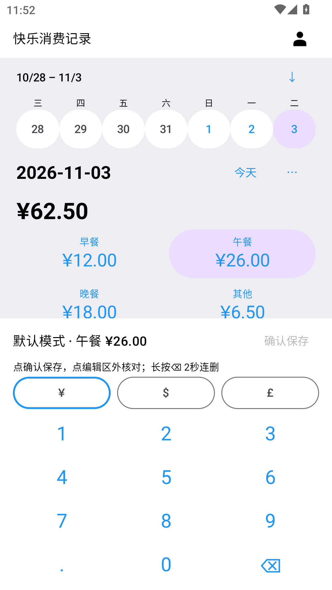
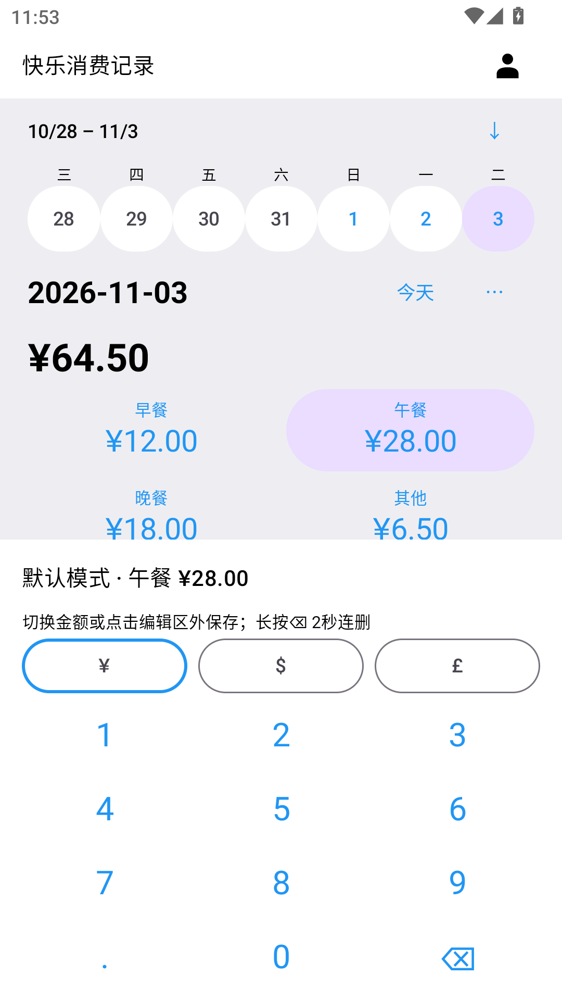
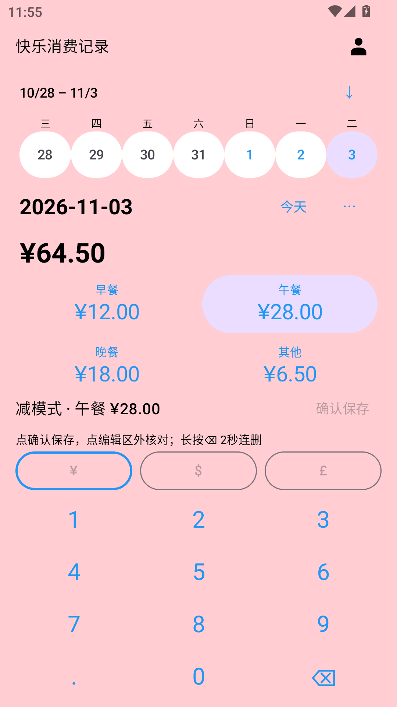

# 快乐消费记录 · Happy Consumption Recorder

轻量离线 Android 应用，按天记录早餐、午餐、晚餐和其他支出。

**v1.6 · Android 8.0+ · 中文 / English / 日本語 · 无网络权限**

[下载 v1.6 APK](https://github.com/foreign-a/happy-consumption-recorder/releases/download/v1.6/app-release_1.6.apk) · [Release 与校验文件](https://github.com/foreign-a/happy-consumption-recorder/releases/tag/v1.6)

## v1.6 更新

- 修复数字键盘黑边，键盘采用当前主题的平面背景，减模式同步显示红色。
- 快捷模式下，修改一项金额后，点击其余三项中的任意一项即可保存本次输入并继续编辑所选金额，无需等四项都改完再点击空白。单击当前正在编辑的金额不会触发保存；点击输入区域外仍可直接保存。
- 谨慎模式的键盘右上角新增确认按钮，可直接保存当前草稿。四项金额之间仍可连续编辑；点击输入区域外时仍显示“确认保存／放弃更改／继续编辑”。未设置过确认方案的账户默认谨慎模式，升级保留已有选择。
- 所有模式均支持长按删除键：持续按住2秒后快速逐位删除，松手即停。

沿用官方签名，直接覆盖安装旧官方版本，不要先卸载。数据库结构未变。消费备份兼容旧格式；记账方式、确认方案、时区、三餐和配色均属本机偏好，不包含在消费备份中。

74项JVM单元测试、31项Android设备回归测试通过；调试和正式构建通过，Lint为0错误、17项警告。

## 原有功能

- 单日平面首页与常驻数字键盘，右上角切换首页与用户页。通过七天日期栏或月历查看过去记录；空白过去日期直接创建全零记录，未来日期不可创建。
- 用户页按账户选择默认模式或加减模式，以及快捷或谨慎确认方案。默认模式输入新金额替换原值；加减模式输入本次增减金额，进入时默认为加，双击任意金额切换适用于四项消费的加／减操作。减模式从双击位置以圆形扩散为红色，再次双击恢复加模式与原背景。保存后清空本次输入并保留编辑位置，可以连续记账。
- 加减沿用原币种；修改币种请切换默认模式。保存失败保留输入；加减保存前核对原记录，避免覆盖已变更的数据。设置按账户保存在本机。
- 日期行“⋯ → 删除”统一选择过去记录，支持跨月多选、全选本月和核对后批量删除，事务失败整批回滚。今天和未来日期受保护。
- 按账户设置IANA时区及三餐时间，打开应用时建议最近且不超过3小时的餐次，其余时段选中其他。
- 月度每日消费圆角条形图、点击日期查看四项明细与合计、每日占比饼图及自定义四类颜色。
- 人民币、美元、英镑分别统计，不作汇率转换；每项金额范围0～9999.99，最多两位小数。默认模式留空保持原值，输入0归零；加减模式输入0不改变金额。
- 本地多账户隔离、中文/英文/日文、加密备份恢复、验证密码删除账户。默认币种仅用于新增记录。

## 界面预览

| 谨慎模式 | 快捷模式 | 减模式 |
| --- | --- | --- |
|  |  |  |

截图来自合成测试账户，用户页及横屏内容可以滚动。

## 安装与备份

覆盖安装旧官方版本可以保留本地账户和记录。卸载或清除数据前，在“用户 → 备份与恢复”按账户导出`.hcrbackup`，记住至少8字符的独立备份密码，文件保存在应用外。恢复后使用原账户密码登录。无云同步或密码找回。

## 验证

[详细验收摘要](docs/reports/version-1.6-report.md)。正式包沿用原证书，签名及升级验证结果见验收摘要。

SHA-256：`8c1b4a6ab1750e774f5a7b93bfd4582efa3bea5d80049febf9dc2a2ddf24ee89`

## English / 日本語

v1.6 removes the keypad's dark edge. In Quick mode, selecting another of the four amounts saves pending input and moves to that amount. Careful mode adds a confirmation button at the keypad's top right; tapping outside still offers Save/Discard/Keep editing. In every mode, hold Delete for 2 seconds to start deleting digits repeatedly; release to stop. Per-account Replace and Add/Subtract modes remain available. Double-tap any amount to toggle the shared operation; subtract reveals a red background from the tap position. Saved deltas clear for continuous entry, and negative results are rejected. Install over the previous official version to retain records.

v1.6では数字キーボードの黒い縁を修正しました。クイックモードでは、別の金額をタップすると入力中の金額を保存して編集先を移します。慎重モードではキーボード右上の確認ボタンで直接保存でき、入力領域の外側では従来どおり保存・破棄・編集続行を選べます。全モードで削除キーを2秒間押し続けると1桁ずつ連続削除し、指を離すと停止します。置換／加減算モード、金額のダブルタップによる加算・減算の切り替え、減算時の赤い背景も引き続き利用できます。旧公式版へ上書き更新してください。

## 从源码构建

需要 **JDK 17**、Android SDK Platform **36**、Build Tools **36.0.0** 和 Platform Tools。仓库包含 Gradle Wrapper；首次构建需要下载依赖。

```sh
git clone https://github.com/foreign-a/happy-consumption-recorder.git
cd happy-consumption-recorder
```

用 Android Studio 打开仓库根目录并配置 SDK，或通过 `ANDROID_HOME` / 本地 `local.properties` 的 `sdk.dir` 指定 SDK 路径。`local.properties` 不应提交。

| 操作 | macOS / Linux | Windows PowerShell |
| --- | --- | --- |
| 构建调试包 | `./gradlew assembleDebug` | `.\gradlew.bat assembleDebug` |
| 单元测试 | `./gradlew testDebugUnitTest` | `.\gradlew.bat testDebugUnitTest` |
| 静态检查 | `./gradlew lintDebug` | `.\gradlew.bat lintDebug` |
| 设备测试 | `./gradlew connectedDebugAndroidTest` | `.\gradlew.bat connectedDebugAndroidTest` |

调试 APK：`app/build/outputs/apk/debug/app-debug.apk`。设备测试会创建测试账户和大量合成记录，请使用专门的测试设备或模拟器。

正式构建启用 R8 与资源压缩。仓库不含官方签名密钥或密码：将 `keystore.properties.example` 复制到用户主目录的 `.happy-consumption-secrets/keystore.properties`，填写自己的密钥信息，运行 `./gradlew assembleRelease`（Windows：`.\gradlew.bat assembleRelease`）。未配置签名时可能生成未签名 APK，输出位于 `app/build/outputs/apk/release/`。自己签名的包无法覆盖官方版本，请妥善保管签名密钥与密码。

技术栈：Kotlin、Jetpack Compose / Material 3、AppCompat、Room、DataStore、Coroutines；构建配置采用 Gradle 9.3.1、AGP 9.1.1。`app/src/main/` 为应用与三语言资源，`app/src/test/` 和 `app/src/androidTest/` 为测试，`app/schemas/` 保存数据库结构。正式包不包含调试数据导入工具或测试设备数据。

## 隐私与许可

无网络权限、广告、上传或云同步。数据保存在本机，密码采用加盐散列，消费记录按账户隔离。[GNU GPL v3](LICENSE)。
