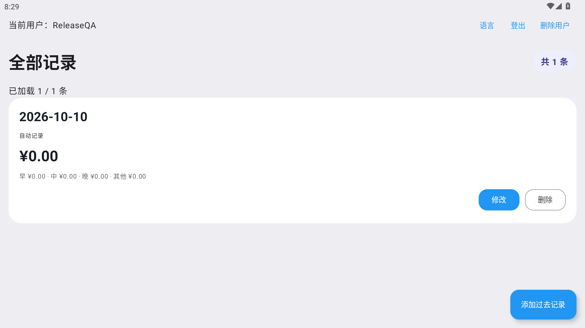
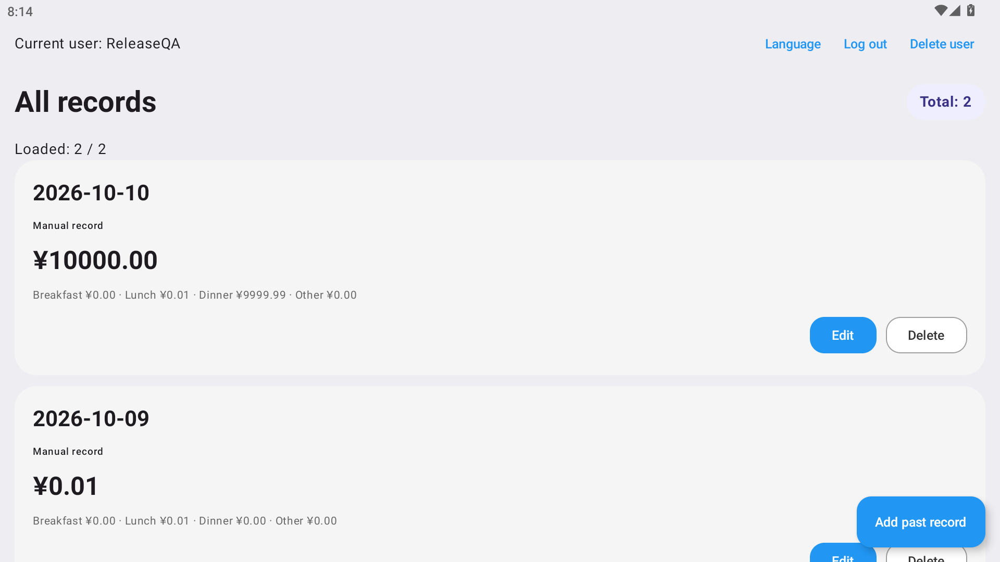
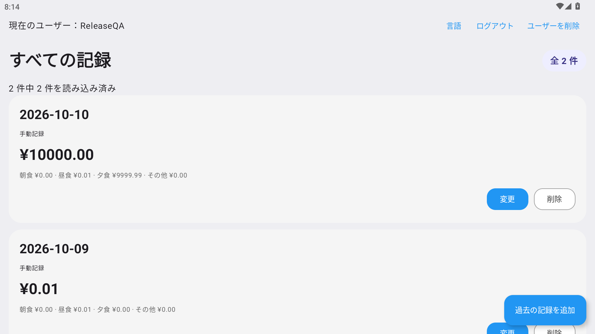

# 快乐消费记录 · Happy Consumption Recorder

一个轻量、离线的 Android 消费记录应用。按天记录早餐、午餐、晚餐和其他支出，自动计算当日合计，让日常记账简单一点。

**Android 8.0 及以上 · 中文 / English / 日本語 · 无网络权限**

[下载最新 APK](https://github.com/foreign-a/happy-consumption-recorder/releases/latest) · [全部版本](https://github.com/foreign-a/happy-consumption-recorder/releases) · [反馈问题](https://github.com/foreign-a/happy-consumption-recorder/issues)

## 功能

- **按天记账**：四类支出与每日合计，记录按日期从新到旧展示。
- **自动创建今日记录**：登录、恢复应用或回到前台时，如果今天还没有记录，会创建金额为零的记录；不会重复创建，也不会补齐未记账的历史日期。
- **补记和修改**：可以添加过去或今天的记录；同一账户同一天只能有一条记录，不支持未来日期。手动添加的记录显示灰色背景，自动生成的记录显示白色背景。
- **金额校验**：每类金额范围为 `0～9999.99`，最多两位小数，内部用整数分保存；金额以 `¥0.00` 格式显示，日期以 `YYYY-MM-DD` 显示。
- **确认操作**：修改经过确认后保存；删除记录需确认，取消操作不会改变数据。
- **本地多账户**：注册、登录、退出和账户间数据隔离。删除账户需要验证当前密码并确认，密码错误时保留账户和记录。
- **三语言切换**：登录页和记录页可切换语言，重启后保留选择；切换时保留会话、已加载记录和列表位置。
- **分页列表**：每页加载 200 条记录，滚动继续加载，读取失败时可重试。
- **本地诊断日志**：按日期保存并清理超过保留期限的日志；不记录密码、盐、密码散列或原始金额。

## 界面预览

| 中文 | English | 日本語 |
| --- | --- | --- |
|  |  |  |

截图使用模拟器中的演示账户和合成数据，拍摄时的记录数量与金额可能不同。

## 快速上手

1. 打开 [最新 Release](https://github.com/foreign-a/happy-consumption-recorder/releases/latest)，下载 `happy-consumption-recorder-1.0.0.apk`。需要 Android 8.0 或更高版本。
2. 在手机上打开 APK；如系统提示，允许当前浏览器或文件管理器安装应用，然后完成安装。
3. 打开应用，点击创建用户，填写用户名、密码和确认密码，创建一个**本地账户**，随后登录。密码至少需要 4 个字符。
4. 今日记录会自动生成。选择修改，填写四项金额并确认；没有支出的项目填写 `0`。
5. 需要补记时添加过去日期的记录。通过语言按钮切换中文、English 或日本語。

### 支持的语言

| 语言 | 覆盖范围 |
| --- | --- |
| 中文 | 页面、表单、按钮、校验提示和确认对话框 |
| English | Pages, forms, buttons, validation messages and confirmation dialogs |
| 日本語 | 画面、フォーム、ボタン、入力チェックと確認ダイアログ |

**English:** Install the APK from [Releases](https://github.com/foreign-a/happy-consumption-recorder/releases/latest) on Android 8.0+, create a local account, and sign in. Edit today's entry or add a past date, enter breakfast/lunch/dinner/other amounts, and confirm. Use the language button to choose English. All accounts and records stay on your device; there is no cloud sync or password recovery.

**日本語:** Android 8.0 以降で [Releases](https://github.com/foreign-a/happy-consumption-recorder/releases/latest) の APK をインストールし、ローカルアカウントを作成してログインしてください。今日の記録を編集するか、過去の日付を追加し、朝食・昼食・夕食・その他の金額を入力して確認します。言語ボタンで日本語を選択できます。データは端末内に保存され、クラウド同期やパスワード再設定機能はありません。

## 数据与隐私

应用不申请网络权限，没有在线账户、云端同步、广告或数据上传。账户信息保存在本地 DataStore，密码使用加盐散列保存；消费记录保存在本地 Room 数据库，并按账户隔离。

删除账户会删除该账户的凭据与消费记录，需要输入当前密码。1.0.0 没有导出、云备份或系统备份恢复功能；**卸载应用或清除应用数据会删除所有本地账户、记录和日志**。请记住自己的密码，当前版本不提供找回密码功能。

## 从源码构建

需要 **JDK 17**、Android SDK Platform **36**、Build Tools **36.0.0** 和 Platform Tools。可使用 Android Studio 或命令行。仓库包含 Gradle Wrapper，无需另外安装 Gradle；首次构建需要下载依赖。

```sh
git clone https://github.com/foreign-a/happy-consumption-recorder.git
cd happy-consumption-recorder
```

使用 Android Studio 打开仓库根目录并配置 SDK，或通过 `ANDROID_HOME` / 本地 `local.properties` 的 `sdk.dir` 指定 SDK 路径。`local.properties` 不应提交。

| 操作 | macOS / Linux | Windows PowerShell |
| --- | --- | --- |
| 构建调试包 | `./gradlew assembleDebug` | `.\gradlew.bat assembleDebug` |
| 单元测试 | `./gradlew testDebugUnitTest` | `.\gradlew.bat testDebugUnitTest` |
| 静态检查 | `./gradlew lintDebug` | `.\gradlew.bat lintDebug` |
| 设备测试 | `./gradlew connectedDebugAndroidTest` | `.\gradlew.bat connectedDebugAndroidTest` |

调试 APK 输出到 `app/build/outputs/apk/debug/app-debug.apk`。设备测试需要连接 Android 设备或模拟器，会创建独立的测试账户和大量合成记录，建议使用专门的测试设备。

### 构建自己的正式包

正式构建默认启用 R8 代码优化和资源压缩。仓库不包含官方签名密钥或密码。

将 `keystore.properties.example` 复制到**用户主目录**下的 `.happy-consumption-secrets/keystore.properties`，填写自己密钥的路径、别名和密码，然后运行：

```sh
./gradlew assembleRelease
```

Windows 使用 `.\gradlew.bat assembleRelease`。输出位于 `app/build/outputs/apk/release/`。未配置签名时可能生成未签名 APK，分发前应检查签名。

自己签名的 APK 无法覆盖安装官方版本。覆盖升级需要相同签名证书和兼容的版本号；请妥善分别备份自己的密钥与密码，密钥丢失后无法继续为原安装签名升级。

### 项目结构与技术栈

```text
app/src/main/         应用代码与三语言资源
app/src/debug/        仅调试构建使用的合成数据导入工具
app/src/test/         JVM 单元测试与合成数据
app/src/androidTest/  Android 设备测试
app/schemas/          Room 数据库结构
docs/images/          公开演示截图
gradle/wrapper/       Gradle Wrapper
```

使用 Kotlin、Jetpack Compose / Material 3、AppCompat、Room、DataStore 和 Coroutines。当前构建配置采用 Gradle 9.3.1、Android Gradle Plugin 9.1.1 和 Compose Kotlin 插件 2.4.20。正式包不包含调试数据导入工具、测试代码或测试设备数据。

## 1.0.0 验证情况

- 25 项 JVM 单元测试、12 项 Android 设备测试通过。
- 在 MuMu Android 12 模拟器上验证正式包安装、记录增删改、三语言切换、删除账户密码验证、错误重试、日志清理与覆盖安装。
- 使用 31,104 条合成记录验证分页；模拟器冷启动平均约 0.79 秒。该结果仅代表测试环境，实体手机仍需进一步验证。
- 已签名正式 APK 为 **2,151,462 字节（约 2.15 MB）**，启用 APK v2 / v3 签名。Release 提供 SHA-256 校验文件。

## 反馈与许可

欢迎在 [Issues](https://github.com/foreign-a/happy-consumption-recorder/issues) 中提供应用版本、Android 版本、复现步骤和预期行为。请勿上传密码、真实消费数据或包含个人信息的完整日志。

本项目遵循 [GNU GPL v3](LICENSE)。
