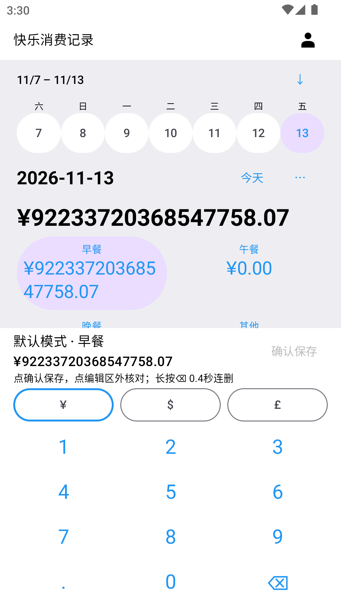
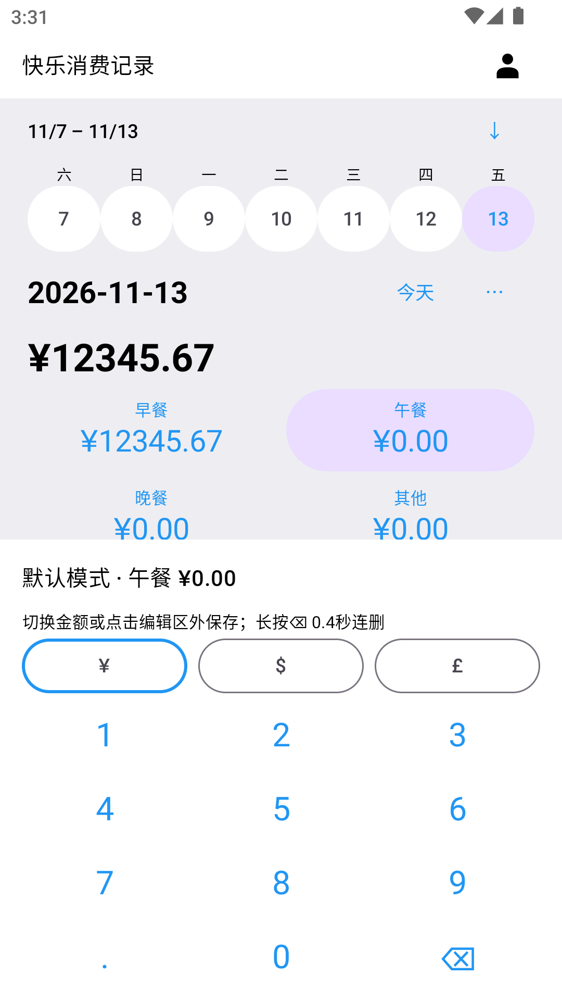
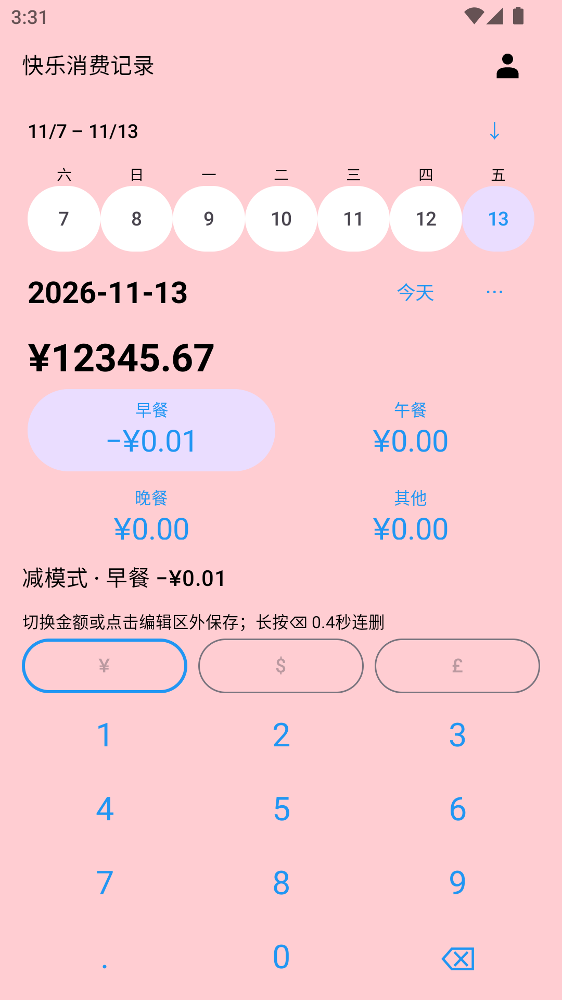

# 快了记账 · Kuaile Ledger

离线 Android 应用，按天记录早餐、午餐、晚餐和其他支出，并支持通过截图选择数字记账。

**v1.8 · Android 8.0+ · 中文 / English / 日本語 · 无网络权限**

[下载 v1.8 APK](https://github.com/foreign-a/happy-consumption-recorder/releases/download/v1.8/app-release_1.8.apk) · [SHA-256 校验文件](https://github.com/foreign-a/happy-consumption-recorder/releases/download/v1.8/app-release_1.8.apk.sha256) · [Release](https://github.com/foreign-a/happy-consumption-recorder/releases/tag/v1.8)

## v1.8 更新

- 应用名称改为“快了记账”。Android 11 及以上可在启用本应用无障碍服务后，使用专用快捷设置入口截图记账；Android 8–10 保留原有记账功能。普通截图不作为记账指令。
- 数字在设备上离线识别，可在对应位置选择一个候选并修正金额，再选择收入或消费以及必选备注；点击“记录”后才保存。原图仅用于临时处理，不长期保存。受系统保护的画面可能无法截取。
- 消费选择早餐、午餐、晚餐或其他内置备注时，金额累加到操作当天对应项；自建备注消费与全部收入保存为独立流水，显示在用户页。收入与消费的自建备注分别保存和复用。
- 用户页分别统计消费与收入，各币种分开计算。新增流水使用账户默认币种；当天已有非零消费项的币种与默认币种冲突时，应用提示冲突并拒绝累加。
- 备份格式包含新增独立流水和自建备注，并支持读取旧版备份。

## 原有功能

- 单日首页显示早餐、午餐、晚餐和其他消费，支持七天日期栏、月历和过去日期记录；用户页支持月度统计、图表和颜色设置。
- 支持默认和加减两种记账模式、快捷或谨慎确认方案，以及日期批量选择与删除。
- 按账户设置时区、三餐时间和默认币种。人民币、美元、英镑分别统计，不进行汇率换算；金额以非负 Long 整数最小货币单位保存，最多两位小数。
- 本地多账户隔离、中文 / English / 日本語和加密备份恢复；无云同步。

## 截图记账

在“用户 → 截图记账设置”查看启用方式，将“截图记账”添加到系统快捷设置。打开需要记账的画面后，使用专用快捷开关，点选数字，修正后选择收支及备注，最后点击“记录”。取消或未确认时不会记账。

截图和识别功能包含在应用中，不需要另装截图或 OCR 插件。截图能力依赖 Android 11 及以上和系统无障碍授权；部分应用或受保护画面可能无法截图。

## 界面预览

下图为 v1.7 的原有记账界面，展示谨慎、快捷和减模式；这些图片使用合成测试账户。

| 谨慎模式 | 快捷模式 | 减模式 |
| --- | --- | --- |
|  |  |  |

## 安装与备份

签名证书与 1.7 官方包一致，可覆盖安装旧官方版本。卸载或清除数据前，可在“用户 → 备份与恢复”按账户导出加密备份，妥善保存文件及备份密码。应用没有云同步或密码找回。

## 验证

- 111 项 JVM 单元测试通过；release 构建与 Lint 通过，Lint 为 0 个错误、22 个警告。
- 隔离 QA 的路由、账务、迁移及账户数据测试分组执行；其中一次组合运行在已有 13 项通过后卡住，剩余项目分开运行。截图对话框 4 项逐项通过，曾出现等待手机启动确认超时后重跑通过；不能将这些结果视为一次完整连续的设备测试。
- 与正式候选同源码的隔离 QA 统计页面测试 1 项通过：使用合成数据核验两种币种的单日与月度收支、内置及自建消费和收入，检查消费不重复计入。
- 前一隔离构建的九张本地样例中，预先标注的 34 个目标均出现未修正且文字一致的独立候选框；结果仅适用于这些目标和该构建。
- 在一台 Android 14 手机的应用详情页，系统普通截图后约 6 秒内未出现截图记账预览；这是一项单设备、单页面观察。
- 正式包覆盖升级前后，同一页面的 45 项可见内容（不含版本标题）对照一致；这不等于全部账户与记录均已核验。完整备份恢复及跨版本全部数据的保留仍未经过完整设备验证。

APK SHA-256：`923bea6862f6c04e6a36c655e7d6dee8fea8500fc7b1b94a700c788349d76a0b`

## English / 日本語

v1.8 adds offline screenshot-based number selection and separate income and custom-expense entries. Screenshot capture requires Android 11 or later and the app's accessibility service; existing accounting features continue to support Android 8–10.

v1.8 はオフラインのスクリーンショット数字選択と、収入・独自メモの支出記録に対応します。スクリーンショット機能には Android 11 以降と本アプリのユーザー補助サービスが必要です。従来の記帳機能は Android 8–10 でも利用できます。
